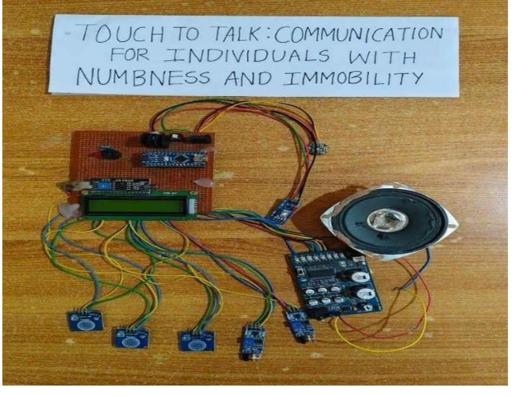
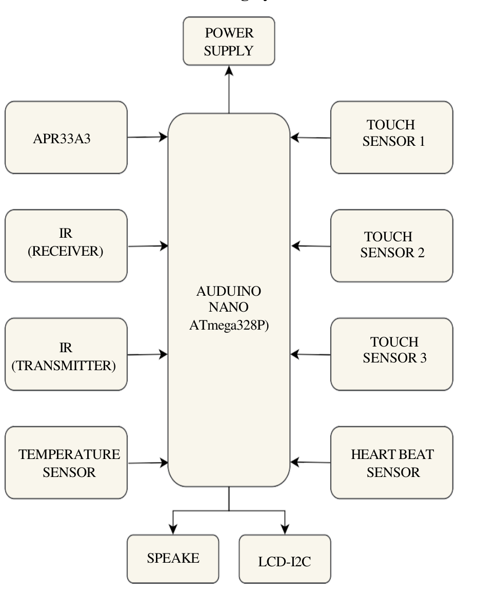
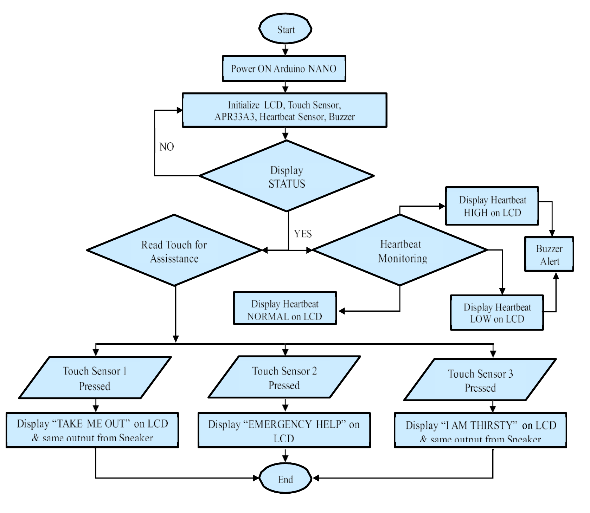
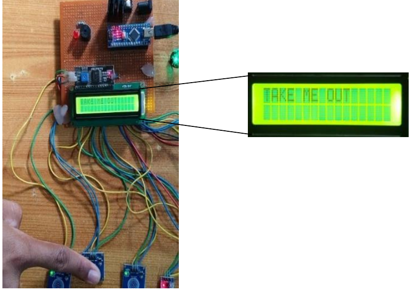
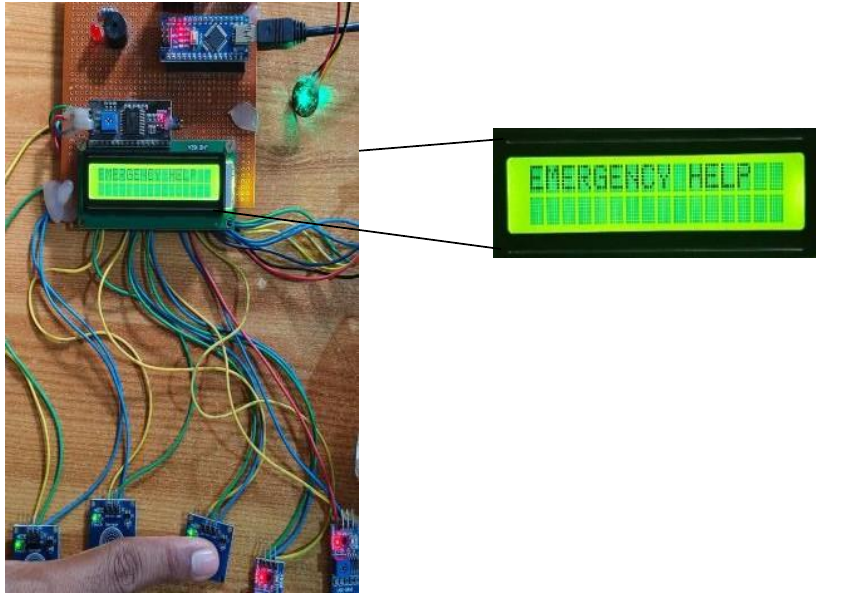
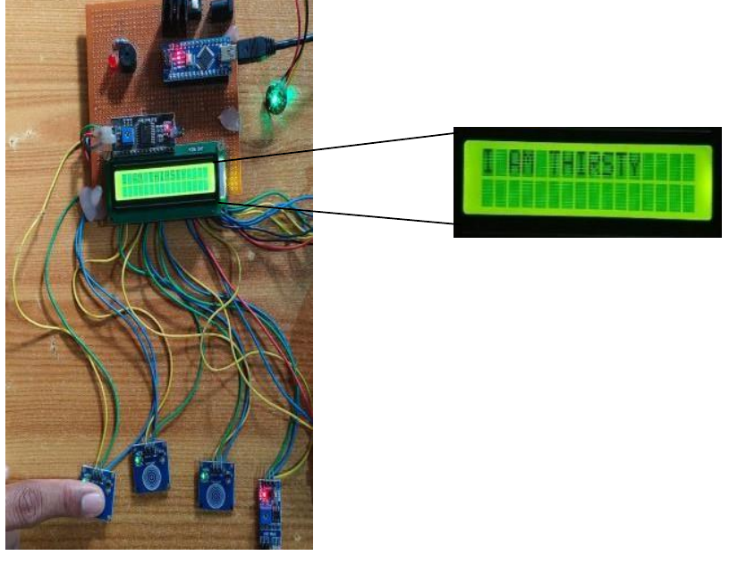
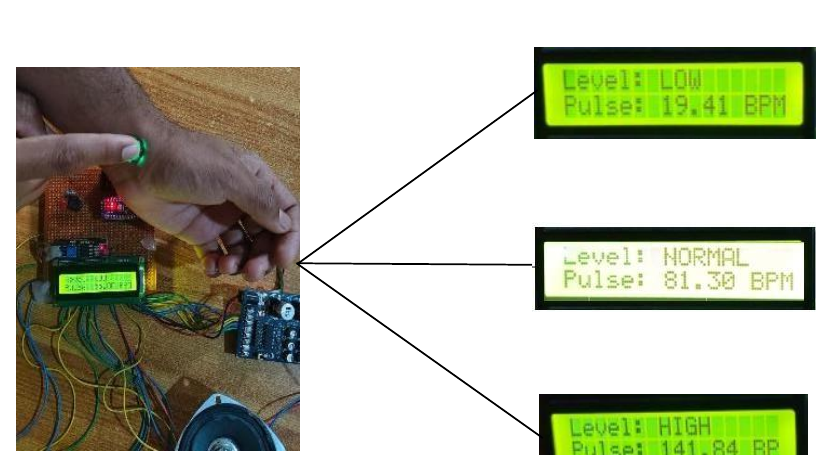

<div align="center">

# 🖐️ Touch-To-Talk

### Communication for Individuals with Numbness and Immobility

An **Arduino Nano–based assistive communication and heart-rate monitoring system** that lets paralyzed patients request help with a single touch — shown on an LCD, spoken aloud by a voice module — while their pulse is continuously monitored and abnormal readings trigger a buzzer alert.

-00979D?logo=arduino&logoColor=white)




</div>

---

## 📑 Table of Contents

1. [Overview](#-overview)
2. [Problem Statement](#-problem-statement)
3. [Key Features](#-key-features)
4. [System Architecture](#-system-architecture)
5. [Working Principle](#-working-principle)
6. [Hardware Components](#-hardware-components)
7. [Results & Demonstration](#-results--demonstration)
8. [Limitations](#-limitations)
9. [Future Scope](#-future-scope)
10. [Repository Structure](#-repository-structure)
11. [Code Availability](#-code-availability)
12. [Related Work](#-related-work)
13. [References](#-references)
14. [Authors](#-authors)
15. [License & Citation](#-license--citation)

---

## 🔎 Overview

Paralysis — caused by spinal-cord injury, stroke, neurological disease or brain trauma — often leaves patients completely dependent on caregivers, and even simple requests such as asking for water or help become difficult. Delayed communication can have serious consequences, especially in a medical emergency.

**Touch-To-Talk** combines two functions in one low-cost embedded device:

| Function | What it does |
|---|---|
| 🗣️ **Assistive communication** | Three touch sensors, placed within easy reach, each send a pre-defined message to the caregiver — displayed on an LCD **and** announced through a speaker. |
| ❤️ **Heart-rate monitoring** | A pulse sensor is continuously evaluated by the Arduino Nano. Low or high BPM is shown on the LCD and sounds a buzzer. |

The system needs no speech, no gestures, and no training — only a light touch.

## ❗ Problem Statement

Existing solutions fall short for patients with severe immobility:

- **Gesture, eye-blink and voice-controlled systems** often need costly hardware, precise motor control or extensive training.
- **Health-monitoring systems** mostly just transmit physiological data and give the patient **no way to communicate**.
- **IoT/cloud systems** can be expensive and depend on stable internet connectivity.

There is a need for an **integrated, affordable** device combining communication support, physiological monitoring and emergency alerting in a single embedded solution.

## ✨ Key Features

- 👆 **One-touch messaging** – 3 touch sensors mapped to 3 pre-defined requests
- 📟 **Visual output** – messages and status shown on an I²C LCD
- 🔊 **Audio output** – the same message played through a speaker via the **APR33A3** voice module
- 💓 **Real-time heart-rate monitoring** with Normal / Low / High classification
- 🚨 **Buzzer alert** for bradycardia and tachycardia
- 💰 **Low cost, portable and simple** – suitable for hospitals and home care
- 🔌 **Standalone** – runs on a regulated supply, no internet required

## 🏗️ System Architecture

The **Arduino Nano (ATmega328P)** is the central controller handling all input and output.

<div align="center">


*Fig. 1 — Block diagram of the Arduino Nano–based system*
</div>

| Inputs | Outputs |
|---|---|
| Touch Sensor 1, 2, 3 | LCD (I²C interface) |
| Heartbeat (pulse) sensor | Speaker via APR33A3 voice module |
| Temperature sensor ¹ | Buzzer |
| IR receiver / IR transmitter ¹ | |

¹ *Shown in the block diagram as part of the modular architecture; the tested workflow and results in the paper cover the touch sensors, heartbeat sensor, LCD, voice module and buzzer.*

The modular design keeps sensing, processing and response synchronized and leaves room to extend the system with further healthcare features.

## ⚙️ Working Principle

<div align="center">


*Fig. 2 — Operational flowchart*
</div>

On power-up the Arduino Nano initializes the LCD, the three touch sensors, the APR33A3 voice module, the heartbeat sensor and the buzzer, then shows its status on the LCD. It then runs two functions **simultaneously**:

### 1️⃣ Heartbeat monitoring

The pulse sensor reading (BPM) is continuously compared against fixed limits:

| BPM range | Classification | LCD message | Buzzer |
|---|---|---|---|
| Below 60 | Bradycardia (low) | `Heartbeat LOW` | 🔔 Alert |
| 60 – 100 | Normal | `Heartbeat NORMAL` | — |
| Above 100 | Tachycardia (high) | `Heartbeat HIGH` | 🔔 Alert |

### 2️⃣ Touch-sensor assistance

| Touch sensor | LCD message | Voice output | Meaning |
|---|---|---|---|
| **Sensor 1** | `TAKE ME OUT` | ✅ same message | Request to be moved / relocated |
| **Sensor 2** | `EMERGENCY HELP` | ✅ same message | Urgent attention needed |
| **Sensor 3** | `I AM THIRSTY` | ✅ same message | Basic need — water |

The system keeps running until power is cut.

## 🧰 Hardware Components

| # | Component | Role |
|---|---|---|
| 1 | Arduino Nano (ATmega328P) | Central control unit |
| 2 | Touch sensors × 3 | Patient input for the three requests |
| 3 | Heartbeat / pulse sensor | Measures pulse rate in BPM |
| 4 | APR33A3 voice module + speaker | Plays the spoken message |
| 5 | LCD with I²C interface | Displays messages and heart-rate status |
| 6 | Buzzer | Audible alert for abnormal heart rate |
| 7 | Regulated power supply | Steady voltage for all modules |
| 8 | Temperature sensor, IR TX/RX ¹ | Shown in block diagram (modular extension) |

📄 More detail: [Bill of Materials](hardware/BILL_OF_MATERIALS.md) · [Circuit Schematic](hardware/CIRCUIT_SCHEMATIC.md)

**Project type:** combined **hardware + software** (embedded systems). The hardware is built from the components above; the firmware is written in the **Arduino IDE**.

## 📊 Results & Demonstration

Testing showed **accurate response to touch inputs** and **successful detection of heart-rate variations**, with little delay between sensor activation and output. The buzzer was effective at attracting attention when the heart rate changed.

### Touch-triggered messages

<table align="center">
<tr>
<td align="center"><br><b>Sensor 1</b><br>“TAKE ME OUT”</td>
<td align="center"><br><b>Sensor 2</b><br>“EMERGENCY HELP”</td>
<td align="center"><br><b>Sensor 3</b><br>“I AM THIRSTY”</td>
</tr>
</table>

### Heart-rate monitoring

<div align="center">

</div>

| Level shown on LCD | Sample pulse reading in the demo |
|---|---|
| LOW | 19.41 BPM |
| NORMAL | 81.30 BPM |
| HIGH | 141.84 BPM |

## ⚠️ Limitations

- Heart-rate readings depend on **finger placement** and are affected if the patient's **fingers move** during measurement.
- Only a **limited set of pre-programmed messages** (3) is currently available.

## 🔮 Future Scope

- More custom commands / messages
- Wireless capability for remote monitoring (e.g. ESP8266-based IoT)
- Companion mobile application
- Additional health-monitoring sensors (e.g. temperature)

## 📁 Repository Structure

```text
Touch-To-Talk/
├── assets/
│   └── images/            # Prototype photos, flowchart and block diagram
├── docs/
│   ├── ARCHITECTURE.md    # Detailed design & control logic
│   ├── RELATED_WORK.md    # Literature comparison
│   └── REFERENCES.md      # Full reference list
├── hardware/              # Bill of materials & circuit schematic
├── firmware/              # Not publicly released (see firmware/README.md)
├── CITATION.cff
├── LICENSE
└── README.md
```

## 🔒 Code Availability

The Arduino firmware and the pin-level wiring of this prototype are **not publicly released**. This repository documents the design, working principle, results and hardware overview for **reference only**. For permission requests, see the [License](#-license--citation).

## 📚 Related Work

Compared with earlier Arduino/IoT patient-monitoring systems — which either lack patient-initiated communication, lack audio alerts, or depend on stable internet — Touch-To-Talk integrates **patient-initiated communication, dual visual + audio output and heart-rate alerting on one low-cost board**. See [docs/RELATED_WORK.md](docs/RELATED_WORK.md).

## 📖 References

The full list of 15 references is in [docs/REFERENCES.md](docs/REFERENCES.md).

## 👩‍💻 Authors

Department of Electronics and Communication Engineering (ECE), **G. Pullaiah College of Engineering and Technology, Kurnool, India**

**Project team**

- Avula Keerthana *(corresponding author, keerthanak93987@gmail.com)*
- Avulapati Lokesh
- Gudupak Juned Basha
- Jangam Shreya
- Ganapa Venkata Danush
- Achutha Sadhanandha Murthy

**Mentor / Project guide:** S. Towseef Ahmed

## 📝 License & Citation

**© 2026 Touch-To-Talk authors. All rights reserved.**

This repository is public for **reading and academic reference only**.

| ✅ You may | ❌ You may not (without written permission) |
|---|---|
| Read and learn from this project | Copy or republish any text, images, schematic, BOM, pin mapping or code |
| Credit the authors and link to this repository when referencing it | Build a replica from its circuit or pin-level design |
| Use the ideas, limitations and future scope as inspiration for your **own independent** work, with credit | Use it commercially |

For permission requests: keerthanak93987@gmail.com. See [LICENSE](LICENSE) for the full terms.

> ⚠️ Research prototype, not a certified medical device.

<div align="center">

*Technology guided by empathy — helping paralyzed people feel heard and cared for.*

</div>
