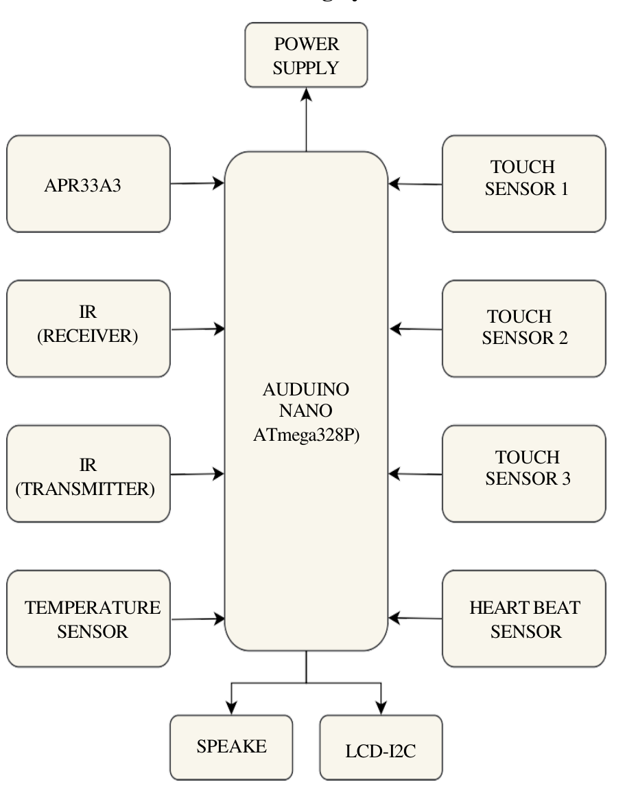
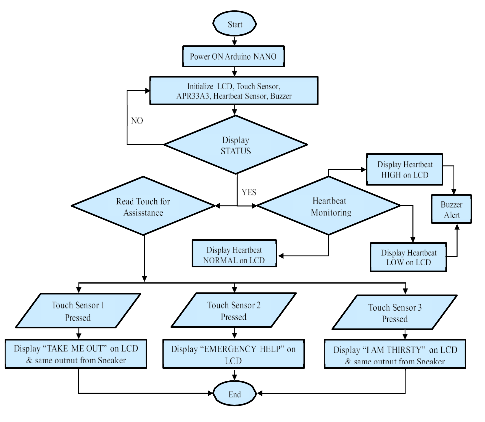
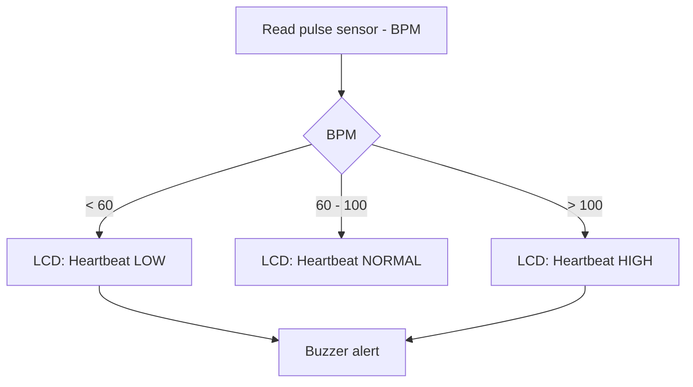
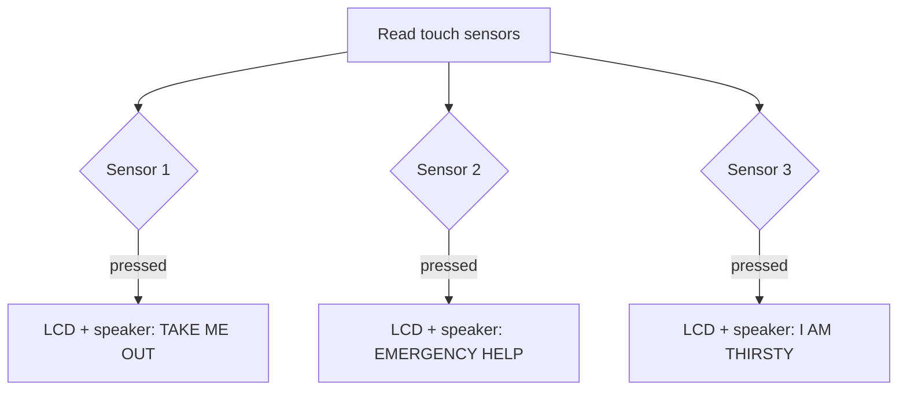

# System Architecture & Control Logic

## 1. Overview
The **Arduino Nano (ATmega328P)** is the core of the system and handles all input and output operations. The system runs from **regulated power supplies** to maintain a steady voltage environment. Sensing, processing and response are synchronized through a modular architecture, which also allows additional healthcare features to be added.



## 2. Blocks
**Inputs:** 3 × touch sensors, heartbeat sensor, temperature sensor, IR receiver, IR transmitter
**Outputs:** LCD (I²C), speaker (via APR33A3 voice module), buzzer
**Support:** power supply

> The temperature sensor and IR TX/RX appear in the block diagram; the workflow and results demonstrate the touch, heartbeat, LCD, voice and buzzer paths.

## 3. Start-up sequence
1. Power on the Arduino Nano.
2. Initialize LCD (I²C), three touch sensors, APR33A3 voice module, heartbeat sensor and buzzer.
3. Display system **STATUS** on the LCD; if not ready, re-initialize.
4. Enter the two concurrent monitoring functions below.



## 4. Heartbeat monitoring
```text
BPM < 60        -> Bradycardia  -> LCD "Heartbeat LOW"    + buzzer
60 <= BPM <= 100 -> Normal       -> LCD "Heartbeat NORMAL"
BPM > 100       -> Tachycardia  -> LCD "Heartbeat HIGH"   + buzzer
```



## 5. Touch-sensor assistance


Each sensor is placed within easy reach so that a patient with limited mobility can activate it. Output is both **visual** (LCD) and **auditory** (APR33A3 + speaker), so the caregiver is alerted even without looking at the display. The system operates continuously until power is removed.

## 6. Design goals
Low cost · portable · simple · reliable · suitable for hospital and home care · improves patient autonomy and reduces caregiver response time.
